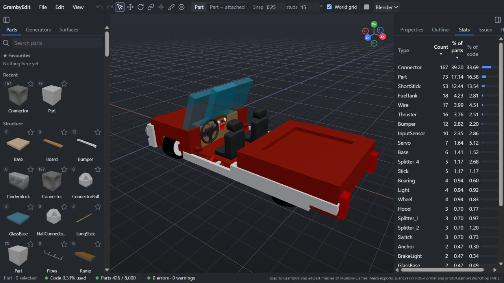

<div align="center">

# 🛠️ GrambyEdit

**Big ideas. Tiny parts. One very long road trip.**

A browser-based 3D blueprint editor for [Road to Gramby's](https://www.roblox.com/games/5796917097/Road-to-Grambys).

Import a share code, build something fun, and bring it back into the game.


[Get started](#get-started) · [Controls](#make-yourself-at-home) · [Run locally](#run-locally) · [Report a bug](https://github.com/GamerHagyma/GrambyEdit/issues)

</div>



## A little more room to build

GrambyEdit gives your creations a proper workspace: a 3D view, precise transforms, reusable assemblies, and tools that make repetitive building much quicker. Whether you're polishing a car or assembling an entirely unreasonable contraption, there's room to experiment.

| What you want to do | What you'll find |
| --- | --- |
| **Edit a creation** | Import share codes or JSON, work with native part meshes and textures, then export a fresh code. |
| **Place things precisely** | Visible sockets, click-to-connect placement, editable ephemeral connection points, and local or world-grid snapping. |
| **Work on a whole assembly** | Select parts or attached branches, move and rotate them together, and edit shared properties in one go. |
| **Add some colour** | Paint selections and regions, auto-colour new parts, or give generated shapes gradients and seeded random palettes. |
| **Skip the repetitive bits** | Twelve shape generators, picked hosts, live previews, and custom GasCap surfaces with four movable corners. |
| **Keep your favourite pieces** | Favourite parts, a local creation library, reusable prefabs, and importable/exportable library backups. |
| **Keep things manageable** | A searchable Outliner, batch visibility controls, undo/redo, a command palette, and part-count and code-length meters. |

## Get started

1. Open the editor and choose **Start empty**, or use **File → Import code** to bring in a creation.
2. Pick a part from the **Parts** tab, then click in the viewport to place it. Right-click when you're done to return to Select.
3. Move, rotate, paint, or try the **Generators** and **Surfaces** tabs. The previews show what you're about to add.
4. Use **File → Export code**, then load the result in Road to Gramby's.

Your library and preferences are stored in your browser. Export a backup when you want to move them to another browser or computer.

## Make yourself at home

Choose **Blender** controls for orbiting around a build, or **Studio** controls for flying through it. You can switch from the toolbar.

| Shortcut | Action |
| --- | --- |
| `G` / `R` | Move / rotate the selection |
| `X`, `Y`, `Z` during a transform | Choose an axis |
| Type a number | Set an exact distance or angle |
| Hold `Ctrl` | Snap to the toolbar's step size |
| `Enter` / `Esc` | Confirm / cancel a transform |
| `Ctrl+Z` | Undo |
| `1` to `6` | Select, Move, Rotate, Connect, Point, Paint |
| `?` | Open the full shortcut guide |

**In the Outliner:** Shift-click selects a range, Ctrl-click toggles individual rows, and right-click lets you hide or show the selection. Hidden parts stay available in the tree, ready to bring back.

**On a surface:** Shift-click its corner buttons or viewport dots to select several corners. Move them together with the gizmo or `G`. Enable **World grid** and hold Ctrl to snap all three coordinates.

## Run locally

You'll need **Node.js 24 or newer** and a browser with **WebGL 2** support.

```sh
git clone https://github.com/GamerHagyma/GrambyEdit.git
cd GrambyEdit
npm ci
npm run assets
npm run dev
```

Open the local URL printed by Vite. To build the static site:

```sh
npm run build
npm run preview
```

The repository includes a [GitHub Pages workflow](.github/workflows/pages.yml) that builds and deploys pushes to `main`. Set the repository's Pages source to **GitHub Actions** to use it. The site base path is `/GrambyEdit/`.

## Want to help?

Bug reports, screenshots, and small example share codes are especially useful. If a creation looks different in game, include both views and the code that reproduces it.

Before sending a change, run:

```sh
npm run assets
npm run typecheck
npm run format:check
npm test
npm run build
```

The main pieces live in `src/core` for blueprint rules and geometry, `src/tools` for editing, `src/viewport` for rendering, and `src/ui` for panels. The asset pipeline lives in `scripts`.

For the deeper details, see the [blueprint format](docs/RTG_BLUEPRINT_FORMAT.md), [editor design](docs/EDITOR_DESIGN.md), and [asset sources](docs/SOURCES.md).

## Still growing

GrambyEdit is under active development. Some complex nested point mounts still differ from the game. Check those assemblies in game, and keep a copy of your original share code while experimenting.

## Made possible by

- **Mumble Games**, creators of Road to Gramby's and its part artwork.
- **[JuanCrakYT / RtG-Format](https://github.com/JuanCrakYT/RtG-Format)** for community format research and mesh exports.
- **[jirrob / GrambysWorkshop](https://github.com/jirrob/GrambysWorkshop)** for reference tooling and exports.
- Everyone testing builds and sharing the wonderfully specific bugs that help this editor improve.

GrambyEdit is a community project, unaffiliated with Mumble Games or Roblox. Game artwork belongs to its respective owners; vendored projects retain their original licences.

<div align="center">

**Have fun building. See you down the road!**

</div>
